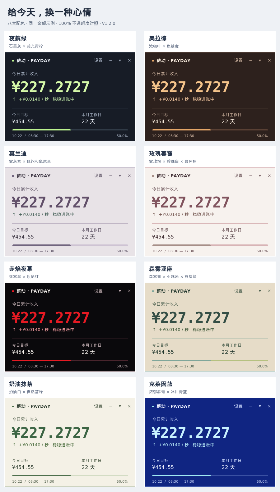

# 薪动 · 上班鼓励器

一个轻巧的桌面悬浮工资计数器。让时间变成看得见的收入。

[下载安装包](https://github.com/WizzenH/xindong/releases/latest) · [使用说明](docs/usage.md) · [源码结构](docs/architecture.md) · [构建说明](docs/building.md) · [更新日志](CHANGELOG.md)



## 功能

- 默认 08:30–17:30 线性计薪，金额保留四位小数，每 100 毫秒刷新。
- 启动时根据系统时间计算，晚开电脑也能显示当天已累计金额。
- 月薪折算日薪，自动计算当月工作日，支持单休、双休及手动标记放假、调休。
- 置顶无边框窗口，支持任务栏最小化、收起到托盘和托盘菜单。
- 八套配色：夜航绿、美拉德、莫兰迪、玫瑰暮霭、赤焰夜幕、森雾亚麻、奶油抹茶、克莱因蓝。
- 默认 90% 不透明，可在 65%–100% 之间调节；配色与透明度均支持预览、保存和取消。
- 支持登录桌面后自动启动，重复启动不会再开第二个计数窗口。

## 安装

### Windows 10 / 11（64 位）

从 [Releases](https://github.com/WizzenH/xindong/releases) 下载 `SalaryMotivator-1.2.1-win64-setup.exe` 并运行。安装包内置运行时，无需另装 Python；安装到当前用户目录，不需要管理员权限。安装包未进行代码签名。

### Debian / Ubuntu / 麒麟

下载 `salary-motivator_1.2.1_all.deb`，在下载目录执行：

```sh
sudo apt install ./salary-motivator_1.2.1_all.deb
```

安装后在应用菜单搜索“上班鼓励器”。系统依赖由 apt 处理，首次安装默认随桌面登录启动，可在设置中关闭。

升级前请先退出旧版。工资、日历及开机启动设置会保留。

## 从源码运行

需要 Python 3.8+ 和 Tkinter。Linux 的托盘还需要系统 PyGObject、GTK 3 和 AppIndicator 支持。

```sh
git clone https://github.com/WizzenH/xindong.git
cd xindong
python3 scripts/run.py
```

Windows 可运行 `python scripts/run.py`，或双击 `scripts/run-windows.pyw`。

## 项目结构

```text
src/salary_motivator/    程序源码，按计算、界面和系统适配分层
  ui/                   设置窗口与外观选项
  platform/             托盘、窗口样式、开机启动及实例锁
  assets/               应用图标
tests/                  计算、主题与桌面交互回归检查
packaging/              deb / exe 构建脚本及固定运行时清单
scripts/                源码启动、截图和 Wine 验证工具
docs/                   使用、架构、构建说明与截图
.github/workflows/      自动检查和正式发布
```

`dist/` 和 `.build-2503/` 是本机生成目录，不纳入 Git。安装包作为 Release 附件发布。

## 计算口径与兼容性

日薪 = 月薪 ÷ 当月实际标记的工作日数。上班前为零，下班后封顶日薪，休息日为零。班内连续计薪，包含午休；不涉及税费、社保、奖金或实际薪资结算。

日历按公历计算月份和星期，法定节假日与调休需手动标记。应用不联网获取日历，也不上传工资数据。

Linux 透明效果需要桌面合成器，托盘需要桌面托盘宿主。托盘不可用时回退到任务栏；托盘宿主退出时自动恢复已隐藏的窗口。具体效果取决于桌面环境。

配色是面向此小组件的原创 UI 适配，风格参考见[设计说明](docs/design.md)。

## 许可证

[MIT](LICENSE)。Windows 包内置的 Python / Tcl / Tk 保留各自许可证，见 [第三方组件说明](docs/third-party.md)。
