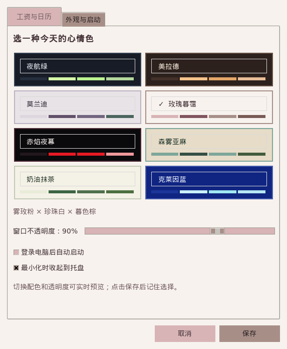

# 使用说明

## 工资与日历

在设置的“工资与日历”页填写月薪、上班/下班时间，选择单休或双休。单休时可指定每周休息的星期。

日历自动计算当前月份的天数和星期。点击日期切换“班/休”，星号表示手动调整；可切换月份并重置本月调休。法定节假日与调休需要手动标记。

上班前金额为零，下班后封顶日薪，休息日为零。启动、跨日或系统时间改变后，会按当前时间重新计算，不依赖程序已运行多久。

## 外观与启动

点击配色卡片实时预览，点击保存后记住选择。取消或关闭设置窗口会恢复原配色和透明度。

- 八套配色：夜航绿、美拉德、莫兰迪、玫瑰暮霭、赤焰夜幕、森雾亚麻、奶油抹茶、克莱因蓝。
- 不透明度可在 65%–100% 间调整，默认 90%。Linux 需要桌面合成器才会呈现半透明效果。
- “登录电脑后自动启动”控制当前用户的登录启动项。
- “最小化时收起到托盘”默认启用，取消勾选并保存后，减号按钮改为最小化到任务栏。

## 窗口与托盘

拖动窗口空白区域移动。右上角：设置、最小化（−）、收起到托盘（▾）、退出（×）。Esc 也可退出。

托盘菜单提供“显示窗口 / 设置 / 退出”。Windows 和 XEmbed 桌面可点击图标恢复；部分 AppIndicator 桌面需从菜单选择“显示窗口”。关闭程序不会取消下次登录启动。

Linux 托盘不可用时回退到任务栏；托盘宿主退出后自动显示已隐藏的窗口。

## 配置与卸载

工资和设置保存在当前用户目录：

- Linux：`$XDG_CONFIG_HOME/salary-motivator/settings.json`，默认 `~/.config/salary-motivator/settings.json`。
- Windows：`%APPDATA%/salary-motivator/settings.json`。

应用不上传工资数据，不内置遥测。配置可能含个人工资，分享日志或截图时请自行检查内容。

升级和卸载前先退出程序。Windows 通过系统“已安装的应用”卸载；Linux 使用 `sudo apt remove salary-motivator`。个人设置会保留。
